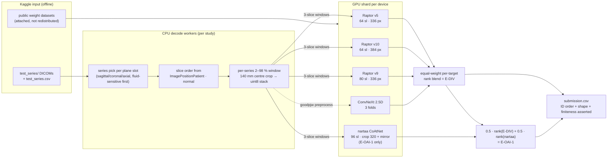

# Knee-MRI abnormality detection — RSNA 2026 (Kaggle)

Code and experiment record from a solo entry in the
[RSNA Knee Abnormality Detection](https://www.kaggle.com/competitions/rsna-knee-abnormality-detection) competition (October 2026).
The task: given one knee-MRI study (several DICOM series in sagittal, coronal and axial planes), output 12 finding probabilities
(ACL, MCL, medial/lateral meniscus, medial/lateral/patellofemoral OA, effusion, synovitis, Baker's cyst, contusion, fracture).
The metric is the macro mean of per-finding ROC-AUC. Inference runs as an offline Kaggle notebook: no internet, 9 h limit.

## Results, stated plainly

| Final | Kaggle submission | What it is | Public LB AUC |
|---|---|---|---|
| **E-OAI-1** | 57300241 | 50/50 per-target rank blend of E-DIV and one more public checkpoint (nartaa, trained partly on OAI data) | **0.947** |
| **E-DIV** | 57190635 | Equal-weight per-target rank blend of four public checkpoints (3 × CoAtNet "Raptor", 1 × 2.5D ConvNeXt) | **0.938** |

- Both finals run **public checkpoints trained by other participants**. I did not train or fine-tune their weights.
  My work in them is the inference system: an independent re-implementation of each checkpoint's DICOM preprocessing and
  model definition (checked against the original code by parity tests), a sharded multi-GPU runner with failure flags, and a
  blend chosen before any scored run.
- The best model **I trained myself** that reached the leaderboard is ENS-02 at **0.750** public AUC. My strongest own models
  (DINOv2 ViT-S full fine-tunes, about 0.88–0.89 on a 58-study gold set) were never submitted, because they did not pass the
  gates I set in advance against E-DIV.
- For scale: on 2026-10-13 the public leaderboard top was 0.966 and the median 0.937 (about 5,900 teams). E-DIV ranked about
  3,054 when its score was fetched. Public-LB scores are on part of the test set only; the private leaderboard is not final
  until after 2026-10-22, and this README will be updated with it.

Every number here comes from the Kaggle scoring page or from the run logs summarised in [docs/EXPERIMENTS.md](docs/EXPERIMENTS.md).

## What is in this repository

| Path | Contents | Origin |
|---|---|---|
| `src/ediv/` | Scored inference code for both finals: stack builder (`raptor_prep.py`), checkpoint loader and window scoring (`raptor_model.py`), ConvNeXt adapter, sharded runner and blend (`run_ensemble.py`) | original; byte-identical to the E-OAI-1 scored bundle (`docs/SCORED_CODE.md`) |
| `src/ensemble/blend.py` | Per-target fractional-rank blend | original |
| `src/validate/` | Bootstrap macro-AUC, study-level weak-label cross-validation, group k-fold | original |
| `src/data/`, `src/train/`, `src/models/`, `src/infer/` | Own early pipeline: DICOM 2.5D bags, gated-attention MIL, feature caching, LoRA fine-tune, EXP-004 inference | original |
| `src/e1/`, `src/e1hr/` | Own DINOv2 slice-MIL full fine-tune (E1), high-resolution dual-view variant (E1-HR), cross-fitted label fusion (FUSE-NX), pre-declared gates | original |
| `src/labels/` | Multilingual lexicon + negation report-label extractor (Spanish, Dutch, English, Greek) | original |
| `kaggle/` | Kaggle script wrappers that produced the two finals | original |
| `tests/` | 76 CPU tests (4 need non-distributed files), including an end-to-end smoke test of the submission CLI on synthetic DICOMs | original |
| `third_party/dreaddevelopment_oracle/` | One public Apache-2.0 notebook, unmodified, used only as a parity-test oracle | third-party, see [THIRD_PARTY_NOTICES.md](THIRD_PARTY_NOTICES.md) |

Not included: competition data, any model weights (mine or third-party), Kaggle credentials, private run logs.

## Architecture



Design points that matter when you read the code:
- **Rank blending.** The metric is ROC-AUC, which only sees order. Averaging per-target ranks ignores each model's calibration.
  Weights were fixed before scoring (equal, then 50/50) and never tuned on the leaderboard or the gold set.
- **Shared decode.** The two 64-slice Raptor arms share one DICOM decode at two stored sizes (`build_stacks`). Decoding, not
  the GPU, dominates runtime (measured 3.67 s/study on 2 × T4 for the 5-arm E-OAI-1 bench).
- **Fail loud, degrade per study.** An undecodable study gets 0.5 for that arm and a flag. More than 1 % errors in any arm aborts
  the run. Above 20 % flagged studies in validation modes also aborts.
- **Parity, not copying.** `raptor_prep.py` and `raptor_model.py` were written from the published preprocessing description.
  `tests/test_ediv_parity.py` checks stacks byte-for-byte and probabilities to 1e-4 against the original notebook; stacks
  were byte-identical on all 6 competition studies checked before the first scored run.
- **Hash pinning.** The OAI-trained checkpoint is SHA-256 checked at load time (`run_ensemble.verified`).

## Install and test (CPU, no data needed)

```bash
git clone <this-repo-url> rsna-knee-2026 && cd rsna-knee-2026
python3 -m venv .venv && . .venv/bin/activate
pip install -r requirements.txt
pytest -q
```

Expected: `72 passed, 4 skipped` in about 5 minutes on a laptop CPU (measured on a fresh clone and venv). The four skips need files that are not distributed:
two parity tests (competition DICOMs + the Raptor v4 checkpoint) and two checkpoint-loading tests (my EXP-004/005 weights).
`tests/test_pipeline_smoke.py` runs the real submission CLI end to end on synthetic DICOMs with random-weight checkpoints.

Run the parity tests yourself after accepting the competition rules:
```bash
RAPTOR_ORIG_NB=third_party/dreaddevelopment_oracle/knee_infer_orig.py \
RAPTOR_V4_CKPT=/path/to/raptor_ft_coatnet_v4_full.pt \
pytest tests/test_ediv_parity.py
```
(the test reads a competition test study from `data/raw/`).

## Reproduce the finals

You need your own Kaggle account, the accepted competition rules, and the public weight datasets listed in
[THIRD_PARTY_NOTICES.md](THIRD_PARTY_NOTICES.md). Each weight dataset has its own terms; read them before use.

On Kaggle (how the scored runs were made):
1. Upload `src/` as a private Kaggle dataset.
2. Create a script notebook from `kaggle/ediv_sub.py` (E-DIV) or `kaggle/eoai1_sub.py` (E-OAI-1). Settings: GPU T4 × 2,
   internet off. Inputs: the competition, your `src/` dataset, and the four (E-DIV) or five (E-OAI-1) weight datasets.
3. Submit the notebook output.

Elsewhere, point the file search at your folders (`os.pathsep`-separated):
```bash
EDIV_SEARCH=/data/rsna:/data/weights python -m src.ediv.run_ensemble --mode test --out ./out --gpus 1 --workers 2
EDIV_SEARCH=/data/rsna:/data/weights python -m src.ediv.run_ensemble --mode test --blend eoai \
  --arms raptor_v5,raptor_v10,raptor_v9,convnext,nartaa_oai --out ./out --gpus 1 --workers 2
```
`--mode gold` scores each arm and the blend on the 58 fully labelled training studies (a sanity check, not a validation score).

Scored environment: Kaggle Python image
`gcr.io/kaggle-private-byod/python@sha256:2757e0c7d1e0a9cb43da657b97e223c321a98f5014bdf64f44f2f6b083ad2b2f` (Python 3.13),
2 × NVIDIA T4. Exact package pins inside that image were not captured; `requirements.txt` pins the versions the CPU tests
passed with.

**Security note on checkpoints.** `src/ediv/raptor_model.load_raptor` calls `torch.load(..., weights_only=False)`, which
unpickles the file and can execute code from a malicious checkpoint. The code is kept exactly as scored. Only the nartaa
checkpoint is SHA-256 checked at load time. Before loading the others, compare their hashes with
[THIRD_PARTY_NOTICES.md](THIRD_PARTY_NOTICES.md) (`shasum -a 256 <file>`). Only use the Kaggle datasets listed there.

## Experiments and lessons

The full table, including every rejected experiment, is in [docs/EXPERIMENTS.md](docs/EXPERIMENTS.md). In short:

1. **The first diagnosis was right; the first fix was not.** My first model (frozen EfficientNet-B0, 224 px, 8 slices, attention
   MIL) scored 0.587, bottom decile. The gap was representation, not labels: the model scored below its own weak labels.
   Swapping in frozen DINOv2, true 2.5D input, a LoRA fine-tune and per-finding heads all stayed at 0.60–0.62 on the gold set.
2. **Labels were the cheapest big lever for my own models.** Retraining the same heads on a consensus of public LLM-read
   report labels moved the leaderboard from 0.605 to 0.750, the largest single gain from my own training.
3. **Full fine-tuning at higher resolution reached the label ceiling, then stopped.** DINOv2 ViT-S full fine-tunes (E1, E1-HR)
   reached 0.879 and 0.890 on the gold set: near the agreement of their training labels with the gold labels (0.876), and
   0.04–0.05 below E-DIV's 0.927. Both failed their pre-declared gates and were stopped.
4. **A better label is not automatically a better model.** Cross-fitted fused labels (report + image teacher) agreed with gold
   much better (0.921 vs 0.876), yet a student trained on them gained nothing (Δ −0.0003, 90 % CI −0.0072 to +0.0069).
5. **Small validation sets mislead.** The 58-study gold set has bootstrap CIs of about ±0.05 and was used by several public
   checkpoint authors for model selection. An early "gold-58 − 0.033 = leaderboard" offset held for two submissions and
   broke on the third. I moved selection to study-level weak-label cross-validation (n = 4,349, CI about ±0.02) and treated
   gold-58 as a diagnostic.
6. **Decorrelated public models blended well; my own models did not add to them.** On the gold set E-DIV scored 0.927 against
   0.920 for its best single arm (n = 58, so directional only), but no model of mine improved E-DIV under the pre-declared
   gates.

## Honest scope

- **Independently trained (my weights):** EXP-004, EXP-005, EXP-006, EXP-007, ENS-01/02 heads, E1, E1-HR, FUSE-NX teachers
  and student. Backbones were initialised from public ImageNet / DINOv2 weights.
- **Public checkpoints used as-is:** Raptor v5/v10/v9 (dreaddevelopment, CC0-1.0), 2.5D ConvNeXt reader (goodpjw2008,
  Apache-2.0), nartaa CoAtNet SWA (research/education terms, OAI-trained; E-OAI-1 only). Training lineage of these is as
  stated by their authors and was not independently verified.
- **Submission 57184755** (Raptor v4, public 0.924) ran another author's public notebook unchanged as a benchmark. It is not
  my solution and is not a final.
- **AI-assisted development.** I built this project with an AI coding assistant (Claude Code). It wrote much of the code and
  documentation under my direction. I set the goals and the approval gates, chose which experiments ran on GPU and which
  submissions were made, and reviewed the results. Tests, parity checks and pre-declared gates are how the code was verified;
  please judge the work on those, not on authorship claims.
- **Not medical software.** These models are competition entries evaluated on one dataset. They are not validated for clinical
  use.

## Licence

Original code: Apache License 2.0 ([LICENSE](LICENSE)). Third-party material keeps its own licence; see
[THIRD_PARTY_NOTICES.md](THIRD_PARTY_NOTICES.md). The competition data is governed by the competition rules and the RSNA MIRA
licence and is not included.
